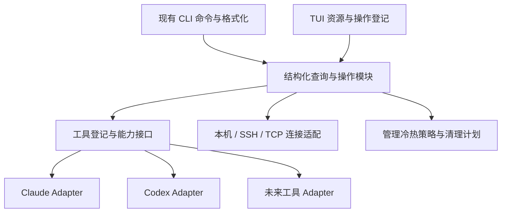

# TUI 实施前：现有项目架构与功能准备度评估

日期：2026-10-21。代码基线：`dfd2362c6abf3b730d876279b96fd7531c2c3d44`。

本次评估针对当前代码、测试、架构文档和已讨论的 TUI v6 需求。没有实施 TUI、修改产品代码、安装依赖或调用真实会话发现/投递。OpenCode、zcode 的原生接口可行性不在本次调查范围；本报告评估的是本项目接纳这些工具的准备度。

## 1. 对三个问题的直接回答

| 问题 | 结论 |
|---|---|
| 现有代码是否满足 TUI 的可扩展需求？ | **部分满足，需要先补通用读取模型和应用接口。**已有 Claude/Codex 两种实现和可测试的接口，但没有贯穿全流程的 Provider 抽象，不能靠 UI 增加一行登记就接入第三种工具。 |
| 是否满足已设计的 TUI 功能？ | **已有多项核心业务能力，但不能完整支撑 v6。**本机发现、星册、认证、管理、投递元数据等可复用；全量分页、只读刷新、结构化体检、清理预览和完整远端发现存在接口或功能缺口。 |
| 项目是否混乱、是否可维护？ | **基础清楚，集成层已出现明显耦合和演进负担。**无需整体重写；需要收拢命令与业务接口、两工具分支、循环依赖及状态读取契约，否则第三/第四工具和 TUI 会扩大改动面。 |

建议沿用现有单包，先做有限的核心模块改造，再实施 TUI。不能仅在 `src/tui/` 建通用接口，而让核心持续按两工具硬编码；也不应把所有后续整理变成 TUI 开始前的全面重写。

## 2. 本次验证与可信范围

- 统计：`src` 下 47 个 TypeScript 文件，14,916 行；`test` 下 52 个测试文件。行数只说明检查范围和热点规模，不作为质量评分。
- 实际执行 `npm run check`：ESLint、TypeScript 构建通过；Vitest **49 个文件通过、3 个跳过；778 项测试通过、11 项跳过，共 789 项**。
- 在运行检查的子进程中清除了 `CROSSCHAT_LIVE`，没有执行真实 Claude/Codex 会话注入。测试中的临时 broker、随机端口和模拟投递属于现有测试。
- 使用 TypeScript AST 排除纯类型导入，检查静态值导入图，发现两组循环依赖，见第 4 节。
- 现有测试通过证明当前已覆盖行为的基线正常，不证明第三工具、完整 TUI、取消和未来协议兼容已经可用；本次未测性能上限和真实第三工具。

## 3. 应保留的基础

1. **原生实现分离。**`src/claude/` 与 `src/codex/` 已把注册表、管道、RPC、proxy、rollout 等原生细节局部化。无需为了统一工具而合并这些原生实现。
2. **依赖可注入。**[SendDeps](D:/workspace/CC/multichat/src/commands/send.ts:76)、[StatusDeps](D:/workspace/CC/multichat/src/commands/status.ts:22)、[DoctorDeps](D:/workspace/CC/multichat/src/commands/doctor.ts:23)、[BrokerDeps](D:/workspace/CC/multichat/src/serve/broker.ts:86) 已支持替换发现、投递、时间、日志等依赖。它们是渐进重构的实际接缝。
3. **有通用数据模块。**[conversationSummaries](D:/workspace/CC/multichat/src/conversation-summary.ts:65) 已分离纯数据汇总；信封、限额、引用编码、平台管道等也有明确职责。对话配对和限流中的 `provider:id` 思路可保留。
4. **管理有明确不变量。**[管理冷热策略](D:/workspace/CC/multichat/src/commands/serve.ts:128) 规定 broker 活着时经管理插座写入，回执失败不能回退直写；[注册表](D:/workspace/CC/multichat/src/serve/registry.ts:156) 有原子写和集中 mutate。TUI 必须复用这些规则。
5. **活性与持久记录已分离。**[stripOnline](D:/workspace/CC/multichat/src/serve/registry.ts:114) 明确静态台账不保存在线真相；roster 提供运行时活性。不能为 UI 方便恢复静态 `online`。
6. **测试有集成价值。**现有权限矩阵、挑战应答、热删星、管理超时不直写、聚合器恢复测试使用临时目录和真实本地连接。[CI](D:/workspace/CC/multichat/.github/workflows/ci.yml:1) 覆盖 Windows/Linux，macOS 是允许失败的观察位。

## 4. 主要架构问题与影响

### 4.1 第三工具需要跨多处修改，Provider 不是完整接缝

当前不仅展示名称固定两家，核心数据和处理流程同样固定：

| 链路 | 证据 | 新工具的影响 |
|---|---|---|
| 调用方身份 | [identity.ts](D:/workspace/CC/multichat/src/identity.ts:13)、[身份识别](D:/workspace/CC/multichat/src/identity.ts:75) | 联合类型、环境探测、冲突判定固定 Claude/Codex/human。环境变量清洗登记表已有扩展思路，但不等于新身份已经接入。 |
| 地址和目标解析 | [resolve.ts](D:/workspace/CC/multichat/src/resolve.ts:35)、[短 ID 解析](D:/workspace/CC/multichat/src/resolve.ts:91) | 返回 session/thread 两种结构，匿名短 ID 规则偏向 Codex 的 hex/UUID。不能假定新工具也是这种 ID。 |
| 对话引用 | [ref.ts](D:/workspace/CC/multichat/src/ref.ts:16)、[类型码](D:/workspace/CC/multichat/src/ref.ts:71)、[解码](D:/workspace/CC/multichat/src/ref.ts:208) | `mc2` 每端点只有 2 bits 类型，0/1/2 已分给两工具和 human。不能只加两个枚举值便同时容纳 OpenCode、zcode，需要兼容扩展方案。 |
| 跨机发送方 | [origin 编解码](D:/workspace/CC/multichat/src/federation.ts:89) | origin 仍只识别两工具；第三工具的回程身份也需要支持。 |
| 本机投递 | [SendDeps](D:/workspace/CC/multichat/src/commands/send.ts:76)、[投递分支](D:/workspace/CC/multichat/src/commands/send.ts:469) | 发现、目标转换、端点限额、排队、回执和错误处理多处认识两工具。不能把 Codex 队列/回执机制当通用默认值。 |
| 成员对账 | [node.ts](D:/workspace/CC/multichat/src/serve/node.ts:937) | 用 Claude 注册表与 Codex rollout 判断活性及工具来源。新工具声明一个 `tool` 字符串，仍不能正常参与对账。 |
| 远端发现 | [StatusPayload](D:/workspace/CC/multichat/src/serve/protocol.ts:247)、[载荷构建](D:/workspace/CC/multichat/src/serve/node.ts:260) | 固定 `claude/codex` 两段，缺通用 Provider、完整 ID、分页与完整性。 |
| 安装与诊断 | [install-skills.ts](D:/workspace/CC/multichat/src/commands/install-skills.ts:31)、[doctor.ts](D:/workspace/CC/multichat/src/commands/doctor.ts:131) | 工具目录和检查项固定；启动器、CLI 装配、卸载也要相应注册化。 |

真正已有的开放点包括 [SessionMemberDecl.tool](D:/workspace/CC/multichat/src/serve/protocol.ts:279) 和 broker 的工具限定地址解析，但整个发现—身份—寻址—对账—投递—回程链尚未统一。

### 4.2 成员唯一键没有包含 Provider

[NodeClient.members](D:/workspace/CC/multichat/src/serve/node.ts:468)、[broker 成员表](D:/workspace/CC/multichat/src/serve/broker.ts:878) 和 [册位查找](D:/workspace/CC/multichat/src/serve/broker.ts:907) 主要用 `sessionId` 建键。工具限定词解析后，[交给本机投递](D:/workspace/CC/multichat/src/serve/node.ts:218) 的目标也只有 `targetSessionId`。

未来工具可能使用局部计数、短字符串等 ID，不保证与其他工具不重复。通用内部身份至少应包含 `providerId + nativeId`；跨机器/星使用时带上相应上下文。当前两工具 UUID 常见场景下未观察到此碰撞，本项是扩展设计风险，不是已确认的数据损坏。

内部模型可以先引入复合身份；改 wire、册格式或 ref 需要独立兼容方案并获用户同意。

### 4.3 两组真实运行时循环依赖

静态值导入图（不含纯类型导入）包含：

```text
commands/send.ts → serve/node.ts → commands/send.ts
commands/send.ts → serve/via-tcp.ts → serve/node.ts

commands/serve.ts ↔ commands/session-star.ts
```

例如为了 [读取节点配置](D:/workspace/CC/multichat/src/commands/send.ts:5)，命令层导入了整个节点模块；节点模块又导入命令函数。配置与选择器可拆成不依赖运行时节点/命令的模块，让 CLI、TUI、节点复用它们。

循环当前没有导致现有测试失败，但会让模块装配、初始化和未来拆分更脆弱，不适宜继续叠加 TUI 依赖。

### 4.4 核心业务依赖 CLI 格式化结果

[deliverViaRunSend](D:/workspace/CC/multichat/src/serve/node.ts:211) 调用 `runSend(json: true)`，随后 [JSON.parse 输出](D:/workspace/CC/multichat/src/serve/node.ts:241)。内部 TCP 投递依赖命令返回的 JSON 字符串。

类似地，[runStatus](D:/workspace/CC/multichat/src/commands/status.ts:427) 同时采集、合并、降级、筛选并生成文本/JSON；[DoctorReport](D:/workspace/CC/multichat/src/commands/doctor.ts:60) 只有 `output/failed`。

建议让应用模块返回 typed snapshot/check/result；CLI 再格式化，TUI 直接消费结果。发送核心也应逐步返回 typed receipt，保持旧 `runSend` 作为兼容包装。由于 TUI 不承担原生聊天，发送核心整理可以与相关集成并行，不必阻塞最早的只读页面。

### 4.5 “读取”缺少稳定的只读、错误和取消契约

- [CLI status](D:/workspace/CC/multichat/src/cli.ts:646) 先 drain outbox，会实际补投；本机与 SSH 都不能高频执行此 CLI 当无副作用刷新。
- [loadBrokerFile](D:/workspace/CC/multichat/src/serve/registry.ts:125) 遇坏形状会写 `.bak` 并返回空星表；不可读也可能被当作空。TUI 必须区分未配置、确实为空、不可读、损坏和上次已知数据。
- [list-nodes/list-members](D:/workspace/CC/multichat/src/serve/broker.ts:1301) 每次读取写审计；高频轮询会让 TUI 自身成为主要日志来源。可用 roster 刷活性，静态凭证低频/手动刷新；更改原审计规则需确认。
- [Codex 列表](D:/workspace/CC/multichat/src/codex/client.ts:105) 固定 20 条且未返回游标；发现、RPC/SSH/TCP 高层大多仅有超时，没有统一取消接口。
- [doctor](D:/workspace/CC/multichat/src/commands/doctor.ts:76) 和部分进程管理使用同步子进程。直接放在 TUI 主循环会阻塞输入，应异步或隔离运行。

应新增只读查询接口与结构化每源错误/完整性/采样时间，并保留现有 CLI 默认行为。写请求已发出后的取消只能表示停止等待，不能显示“已撤销”。

### 4.6 集中职责与边界验证需要收拢

[commands/serve.ts](D:/workspace/CC/multichat/src/commands/serve.ts:195) 不只处理 CLI 参数，还包含管理业务、文本、broker/聚合器装配、进程扫描与停止。问题是不同改动理由汇集，并非文件长本身。

`Broker` 的连接、pending 请求和星运行时状态由一个 owner 持有有合理性，不应为降低行数拆成互相回调的许多类。可以按实际需要抽出纯目标选择、管理操作分发和册位转移规则。

[parseFrame](D:/workspace/CC/multichat/src/serve/protocol.ts:461) 只确认 JSON 对象和已知 op 后断言为 `Frame`；字段验证分散在各处理器。引入 Provider、完整身份等新字段前，应梳理每帧的运行时解码与兼容测试，不能把 TypeScript 类型当作 wire 验证已经完成。

### 4.7 架构文档落后于当前实现

[docs/architecture.md](D:/workspace/CC/multichat/docs/architecture.md:22) 仍有“没有守护进程”“无任何网络监听”的全局表述，而当前存在 broker/node 常驻服务及 [WebSocket 监听](D:/workspace/CC/multichat/src/serve/broker.ts:287)。原本的本机投递原理仍有价值，但缺少现在的进程拓扑、TCP 权限和持久化角色。

这会误导后续接入者把早期两工具单机设计当当前全局约束。应更新事实与模块方向，不以整仓移动目录代替架构梳理。

## 5. TUI 功能准备度矩阵

A＝已有底层能力可复用；B＝新增内部接口/重构可保持既有行为；C＝涉及原有功能或协议变化，先交具体方案等待同意。A/B 不表示界面已经实现。

| 功能 | 级别 | 当前实况与缺口 |
|---|---|---|
| 本机 Claude 与匿名会话 | A+B | 现有活进程注册表含完整 ID；需保留不可读/坏登记等错误，不把所有失败归空。范围不含全部历史。 |
| 本机 Codex 全部可发现会话 | B | 保留游标并分页，记录完整性；新增 TUI 查询路径，不改变旧 CLI/send 默认扫描范围。 |
| 状态、投递记录、滞留 | A+B | 读取器与汇总存在；提取 typed snapshot。投递元数据不是原生聊天，也不证明任务完成。 |
| ctx / SSH 目标 | B | 没有统一连接资源和完整 SSH 配置读取器；简单 Host 检查不能替代 Include/Match 等能力。配置选择与写入需明确所属模块。 |
| SSH 会话查询 | B+C | 旧远端 status 可返回数据，但会补投，完整 ID 和分页不足；无副作用完整枚举需新的远端读取契约及兼容方案。 |
| SSH doctor | A+B/C | 文本与退出码可读；逐检查项结果需结构化。若新增远端 CLI 参数则属 C。 |
| TCP 星、节点、成员、全星星籍视图 | A+B | roster 已含机器与在线/下线成员，可聚合；不提供原生 idle/busy，未提供时必须显示未知/未提供。 |
| TCP 所有节点可发现会话 | B+C | 单节点 status-query 现成；完整 ID、分页、完整性和通用 Provider 载荷尚缺。旧端只能诚实展示部分结果。 |
| 加星、删星、改名、发吊钥 | A+B | 业务现成，但需提取 typed 管理接口并保留 broker 唯一写者策略；TUI 不直接调用整个 runServe。 |
| 移除节点并立即断连 | **C** | 当前 remove-node 删除凭证，没有主动关闭已认证连接。v6 的立即断连是目标要求，超出现有实现，须单列变更。 |
| 收编、删册位 | A+B | 收编会保障/启动聚合器，非纯改登记；匿名所选对象需要按核实身份收编接口。删册不杀原生进程。 |
| 当前机器显示名 | A+B | 全局/按星覆盖现成，生效路径区分 broker 热改和节点重启。TCP 不支持任意远机改名。 |
| 服务起停 | A+B | 现有入口可复用；需异步/隔离、结构化状态与启动就绪确认，不能把 spawn 成功当服务已运行。 |
| doctor 明细 | B | 检查、判定、文案分离，保留原文本和退出码；新探测、自动修复属于 C。 |
| 日志、审计 | A+B | 本机文件有数据；需有界读取、轮转、跟随、完整行详情。TCP 远端日志接口不存在。 |
| 收件与断点列表 | A+B | 本机可读元数据；不能外推成远程目录浏览或完整传输历史。 |
| 清理预览与确认 | B | 当前 clean 计算完立即删除，无 preview 服务。提取同一 plan/execute，保留既有规则；规则变化为 C。 |
| 技能安装与维护 | A+B | 安装路径可复用；第三工具目录和诊断需注册化。卸载现有数据不等于已卸载 npm 包。 |
| 所有资源的按键、过滤、列宽、只读详情 | TUI新增 | 可在统一资源/动作登记与通用界面实现；不应把业务/权限规则复制进页面。 |

## 6. 两个不能直接按前稿实现的管理场景

### 移除节点不等于主动断连

[本机 remove-node](D:/workspace/CC/multichat/src/serve/broker.ts:500) 和 [远端 remove-node](D:/workspace/CC/multichat/src/serve/broker.ts:1354) 调用 [removeNodeFor](D:/workspace/CC/multichat/src/serve/registry.ts:250)，主要删除台账条目；未发现该路径关闭目标已认证连接的操作。

所以前稿“删除后立即断开”不能标成现成功能。可选择维持现有撤销后续认证语义，或批准新增立即断连并设计在线表、成员下线、回执等一致性。此处没有实施任何改变。

### `runServe` 不是纯改名接口

[nameArg 分支](D:/workspace/CC/multichat/src/commands/serve.ts:257) 改名后没有独立 return，后续在没有其他一次性动作时可进入 [runForegroundBroker](D:/workspace/CC/multichat/src/commands/serve.ts:351)。这说明入口同时承担配置与启动，不能当作 TUI 列表的纯 rename 操作。应提取独立管理接口；是否改变旧 CLI 的行为另行决定，不在本次审查中直接判定或修复。

## 7. 推荐的改造顺序

### 第一阶段：TUI 前完成的最小基础

1. **确认契约和模块方向。**保留当前 CLI 文本/JSON/退出码、旧协议、冷热管理、册位生命周期和清理规则；更新过时架构说明。
2. **拆出无运行时依赖的配置/选择器模块。**解决 node 配置把命令引入整个节点运行时、serve 与 session-star 互引的问题。迁移调用者，必要时保留旧导出兼容。
3. **建立通用会话读取模型。**以 Claude/Codex 两个真实 Reader Adapter 验证 Interface；保留 `providerId/nativeId`、可空名称、raw 状态、分页、每源错误/完整性和取消。未知第三工具不伪装成 Codex。
4. **提供 TUI 必需的结构化查询/操作。**状态、doctor checks、管理 request/result、清理 plan/execute 与通用日志读取。保留原 CLI 包装及输出。管理写入继续经过 broker 的现行策略。
5. **建立扩展契约测试。**第三测试 Adapter 不改通用页面，未知状态不丢行，匿名分页正确，同 ID 不同 Provider 不覆盖；操作固定目标，取消读取不触发写入。

完成这些便可在同包 `src/tui/` 实施通用页面，不必等待实际接入 OpenCode/zcode，也不必先拆完所有大文件。

### 第二阶段：按相关实现点继续解耦

- 将发送核心结果与 CLI formatter 分离，TCP 桥直接消费 typed receipt。
- 把成员对账、活性与启动后识别的工具差异委托给 Adapter，先保持现有两家行为。
- 按实际修改点提取 broker 纯目标选择、管理处理和公共测试 fixture。
- 处理高层取消/进度与同步探测，保证界面输入不阻塞。

### 第三阶段：先获同意的功能/协议提案

- 通用身份、复合成员键、ref/origin 的版本与兼容方案。
- 远端只读发现：完整 ID、Provider 列表、分页/完整性、能力协商与旧端降级。
- 移除节点是否立即断开已认证连接，以及相应册位与回执语义。
- 其他既有命令默认行为、审计频率、配置迁移、清理/卸载判定变化。

以上方案应先提供现状、拟改行为、受影响命令/协议、兼容与保留现状的替代办法；待用户同意后实施该部分。

### 第四阶段：真实工具接入

分别核验 OpenCode、zcode 的原生身份、发现、收件、生命周期和鉴权能力，再决定支持哪些 capability。发现、投递、启动、技能安装、诊断、回执不要求每家全部具备，不把新工具机械套进 Codex 的队列模型。

## 8. 目标模块关系与验收



Provider 负责原生工具差异，Context 负责连接与远端兼容；远端能力由远端报告，不能由本机 Adapter 补造。公共模块不依赖 TUI 框架，也不反向依赖 CLI 格式化。Adapter 的职责是隐藏实际变化，不是给每个函数增加一层转发。

关键验收：

- 原有 `npm run check` 继续通过，旧输出/协议/权限行为按保留契约验证。
- 关键两组运行时循环解除；配置读取不再装载节点/发送运行时。
- TUI 刷新不补投、不修复、不写备份；未配置/损坏/不可读/部分失败可区分。
- 第三测试工具具名/匿名/未知状态/局部失败可共用列表与详情；不同工具同 native ID 的内部模型不覆盖。
- 真正远端和持久身份迁移在独立获批方案下验证旧新兼容，不把新增内部类型当协议已泛化。
- 管理操作失败不回退直写；确认目标不随刷新变化；已发送写操作取消等待时显示结果未知。
- 不把构建通过或现有用例通过等同于 TUI 和第三工具已验收。

本报告只完成评估和建议，未开始任何核心改造或 TUI 产品实现。
